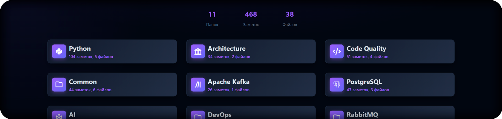

<p style="text-align: center">
Ответы на частые вопросы с собеседований по Python, базам данных, очередям и другим темам, связанным с веб-разработкой.
<br>
Доступно по ссылке <a href="https://notes.alex.md">https://notes.alex.md</a>
</p>

### Добавить свою заметку
Заметки это обычные markdown файлы.

Заголовок первого уровня (начинающийся с #) становится заголовком файла.  
Заголовок второго уровня (начинающийся с ##) становится заголовком заметки.  
Если нужно больше уровней вложенности, то лучше разделить на отдельные файлы.  

У каждой заметки должны быть метаданные - уровень и автор (github id), пример:  
```markdown
## Заголовок заметки
<!-- junior 123456 -->
Текст заметки
```

Получить github id можно через api:  
`https://api.github.com/users/ВАШ_GITHUB_ЛОГИН`  

Чтобы заметка отображалась на сайте нужно запустить `build.py`

### Похожие проекты
<table>
    <tr>
        <td><a href="https://github.com/karanpratapsingh/system-design">https://github.com/karanpratapsingh/system-design</a></td>
        <td>System design</td>
    </tr>
    <tr>
        <td><a href="https://github.com/cheatsnake/backend-cheats/">https://github.com/cheatsnake/backend-cheats/</a></td>
        <td>Огромный список тем</td>
    </tr>
    <tr>
        <td><a href="https://github.com/arturpanteleev/backendinterview">https://github.com/arturpanteleev/backendinterview</a></td>
        <td>PHP, Golang, Алгоритмы, Базы данных</td>
    </tr>
</table>
